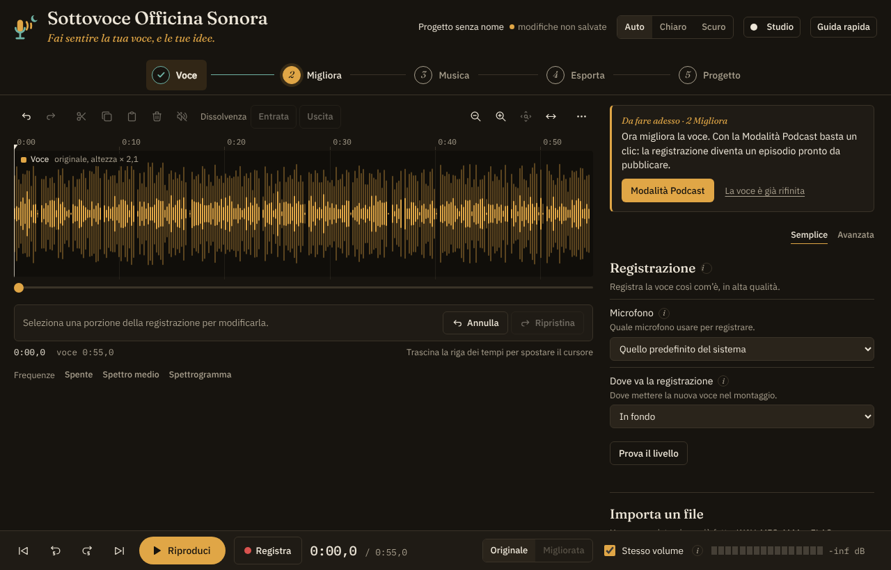
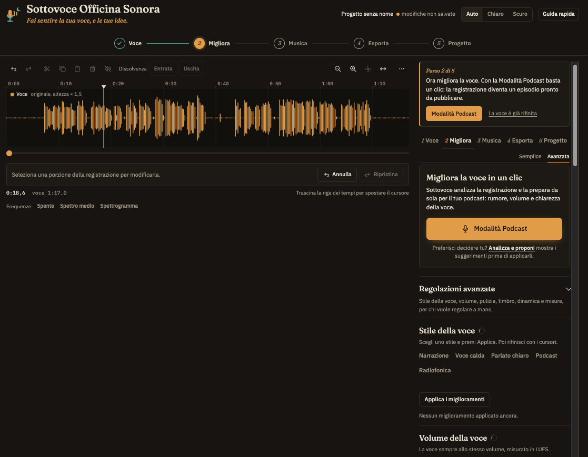
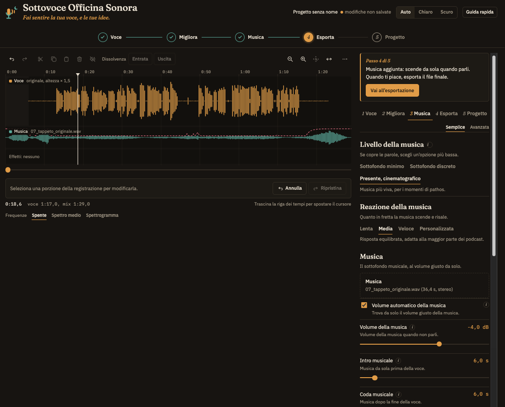

# Sottovoce Officina Sonora

**Rifinitura della voce e mix con la musica per podcast, direttamente nel browser.**

👉 **[Apri l'app](https://raefsky.github.io/sottovoce/)**, niente da installare, niente account.

*Fai sentire la tua voce, e le tue idee.*

## In tre passaggi

**1. La voce.** Registri o importi la tua voce.

**2. Migliora.** Un clic con la Modalità Podcast, oppure scegli uno stile e rifinisci a mano.

**3. La musica.** Aggiungi il tappeto: scende da solo quando parli e risale nelle pause.

## Cosa fa

- **Pulisce la voce** con RNNoise, un modello di intelligenza artificiale che toglie il rumore di fondo
- **Stili pronti per la voce:** Narrazione, Voce calda, Parlato chiaro, Podcast, Radiofonica
- **Rifiniture mirate:** de-esser per le "s", attenuazione di p e b esplosive, anti-ronzio, respiri e click di bocca
- **Registrazione e montaggio:** registri direttamente nell'app, tagli, crei silenzi, accorci le pause troppo lunghe
- **Volume costante** in LUFS, lo standard delle piattaforme di podcast
- **Ducking automatico:** la musica si abbassa quando parli e risale nelle pause
- **Esporta** in MP3 o WAV, con titolo, autore e copertina già inseriti nel file

## I tuoi file restano tuoi

Tutto il lavoro avviene nel tuo browser. I file audio non vengono caricati su nessun server e non lasciano mai il tuo computer.

## Come è nata

Poco più di un anno fa mi sono avvicinato al mondo dei podcast, soprattutto per ragioni didattiche. Su consiglio di alcuni colleghi ho aperto un account su Spreaker e ho cominciato a registrare.

All'inizio ho usato i programmi classici, come Audacity e ocenaudio per il montaggio e la versione gratuita di Adobe Podcast per migliorare la voce. Funzionavano, ma ogni episodio richiedeva tanti passaggi tra un'app e l'altra. Ho cercato in rete qualcosa di più semplice, senza trovare davvero quello che mi serviva.

Così, a un certo punto, mi sono chiesto: perché non costruirla io, con l'aiuto di Claude Code? È nata così Sottovoce, e oggi ogni episodio di **[Fuori Scala - Ai Limiti della Scienza](https://www.spreaker.com/podcast/fuori-scala-ai-limiti-della-scienza--6746440)** passa da qui.

🎧 Se l'app ti è utile, l'unico grazie che chiedo è un ascolto.

## Autore

Roberto Lanza. Insegno scienze, racconto storie in un podcast e mi diverto a costruire gli strumenti per farlo.

## Licenza

© 2026 Roberto Lanza. Sottovoce è distribuita con licenza [PolyForm Noncommercial 1.0.0]([https://polyformproject.org/licenses/noncommercial/1.0.0/](https://polyformproject.org/licenses/noncommercial/1.0.0)): puoi usarla, studiarla e modificarla liberamente per uso personale, didattico e comunque non commerciale. Non è consentito venderla o usarla a scopo di lucro.

## Componenti di terze parti

Sottovoce include, senza modifiche e con le rispettive licenze: RNNoise (BSD-3-Clause), @jitsi/rnnoise-wasm (Apache-2.0) e lamejs (LGPL-3.0). I dettagli sono nella sezione "Informazioni e licenze" dell'app.
