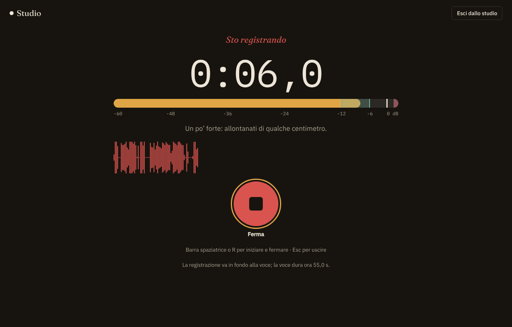
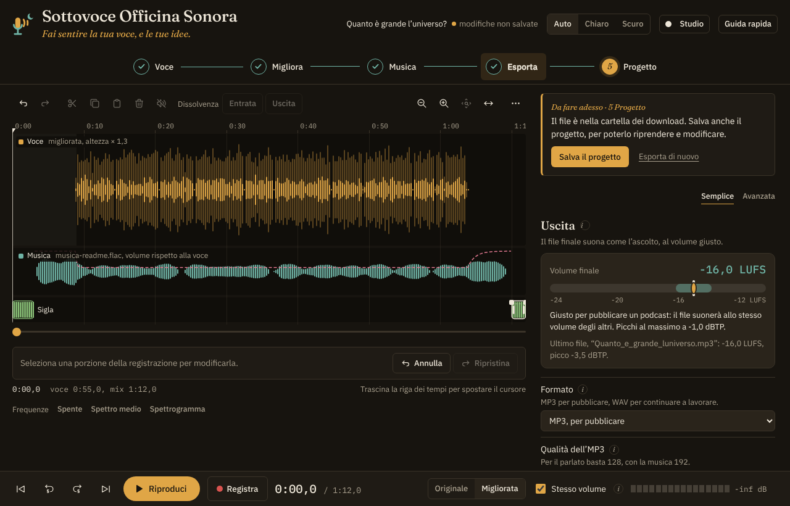

# Sottovoce Officina Sonora

**Rifinitura della voce e mix con la musica per podcast, direttamente nel browser.**

👉 **[Apri l'app](https://raefsky.github.io/sottovoce/)**: niente da installare, niente account.

*Fai sentire la tua voce, e le tue idee.*

## In cinque passi

**1. La voce.** Registri nello **Studio**, a tutto schermo, oppure importi una registrazione già fatta. Poi monti: tagli, silenzi, pause troppo lunghe.

**2. Migliora.** Un clic con la **Modalità Podcast**, oppure scegli uno stile, dopo averlo ascoltato sulla tua voce con **Ascolta 10 s**, e rifinisci a mano.

**3. La musica.** Sigla all'inizio, tappeto sotto la voce, chiusura alla fine. Il tappeto scende da solo quando parli e risale nelle pause.

**4. Esporta.** MP3 per pubblicare o WAV per lavorarci ancora, con titolo, autore e copertina. Il misuratore ti dice se il volume è quello giusto per i podcast.

**5. Progetto.** Il lavoro si salva da solo. Con un **modello di serie** il prossimo episodio parte già con sigla, musica, chiusura e dati al loro posto.

## Cosa fa

- **Pulisce la voce** con RNNoise, un modello di intelligenza artificiale che toglie il rumore di fondo
- **Stili pronti per la voce:** Narrazione, Voce calda, Parlato chiaro, Podcast, Radiofonica, da ascoltare sulla tua voce prima di sceglierli
- **Rifiniture mirate:** de-esser per le "s", attenuazione di p e b esplosive, anti-ronzio, respiri e click di bocca
- **Studio per registrare:** il tempo grande, il livello del microfono con la zona giusta e un solo pulsante
- **Montaggio:** tagli, crei silenzi, accorci le pause troppo lunghe; tutto si annulla
- **Volume costante**, misurato in LUFS come richiedono le piattaforme di podcast
- **Sigla e chiusura** sempre al loro posto, anche quando la voce cambia lunghezza
- **Ducking automatico:** la musica si abbassa quando parli e risale nelle pause
- **Modelli di serie:** sigla, musica, chiusura, regolazioni, autore e copertina pronti per ogni episodio nuovo, con il numero dell'episodio che sale da solo
- **Progetto salvato in un file:** con Chrome ed Edge ogni modifica si salva da sola nel file che scegli
- **Esporta** in MP3 o WAV, con titolo, autore e copertina già inseriti nel file
- **Si usa anche su tablet e telefono**, con i comandi a misura di dito

## I tuoi file restano tuoi

Tutto il lavoro avviene nel tuo browser. I file audio non vengono caricati su nessun server e non lasciano mai il tuo computer. Una volta aperta, l'app funziona anche senza internet.

## Quale browser

Sottovoce funziona con Chrome, Edge, Firefox e Safari aggiornati. Con **Chrome ed Edge** il progetto si collega a un file sul computer e si salva da solo; con gli altri browser "Salva il progetto" scarica il file, come un documento qualsiasi.

## Novità della versione 2

- Studio per registrare a tutto schermo, e la forma d'onda visibile mentre registri
- Sigla e chiusura, e modelli di serie
- Progetto collegato a un file, con salvataggio automatico
- "Ascolta 10 s" per sentire uno stile prima di applicarlo
- Misuratore del volume finale nella scheda Esporta
- Una sola navigazione, più spazio alla linea del tempo, schermi touch più comodi
- Forma d'onda con picco e volume medio, e musica disegnata con il suo volume rispetto alla voce

I progetti salvati con la versione 1 si aprono anche nella 2. La versione 1 resta scaricabile dalla [Release v1.0.0](https://github.com/raefsky/sottovoce/releases/tag/v1.0.0).

## Come è nata

Poco più di un anno fa mi sono avvicinato al mondo dei podcast, soprattutto per ragioni didattiche. Su consiglio di alcuni colleghi ho aperto un account su Spreaker e ho cominciato a registrare.

All'inizio ho usato i programmi classici, come Audacity e ocenaudio per il montaggio e la versione gratuita di Adobe Podcast per migliorare la voce. Funzionavano, ma ogni episodio richiedeva tanti passaggi tra un'app e l'altra. Ho cercato in rete qualcosa di più semplice, senza trovare davvero quello che mi serviva.

Così, a un certo punto, mi sono chiesto: perché non costruirla io, con l'aiuto di Claude Code? È nata così Sottovoce, e oggi ogni episodio di **[Fuori Scala - Ai Limiti della Scienza](https://www.spreaker.com/podcast/fuori-scala-ai-limiti-della-scienza--6746440)** passa da qui.

🎧 Se l'app ti è utile, l'unico grazie che chiedo è un ascolto.

## Autore

Roberto Lanza. Insegno scienze, racconto storie in un podcast e mi diverto a costruire gli strumenti per farlo.

## Per chi sviluppa

L'app pubblicata è un file solo, `index.html`, montato dai sorgenti in `src/`. Come montarla e provarla è spiegato in [SVILUPPO.md](SVILUPPO.md).

## Licenza

© 2026 Roberto Lanza. Sottovoce è distribuita con licenza [PolyForm Noncommercial 1.0.0](https://polyformproject.org/licenses/noncommercial/1.0.0): puoi usarla, studiarla e modificarla liberamente per uso personale, didattico e comunque non commerciale. Non è consentito venderla o usarla a scopo di lucro. Il testo completo è nel file [LICENSE](LICENSE).

## Componenti di terze parti

Sottovoce include, senza modifiche e con le rispettive licenze: RNNoise (BSD-3-Clause), @jitsi/rnnoise-wasm (Apache-2.0) e lamejs (LGPL-3.0). I dettagli sono nella sezione "Informazioni e licenze" dell'app.
